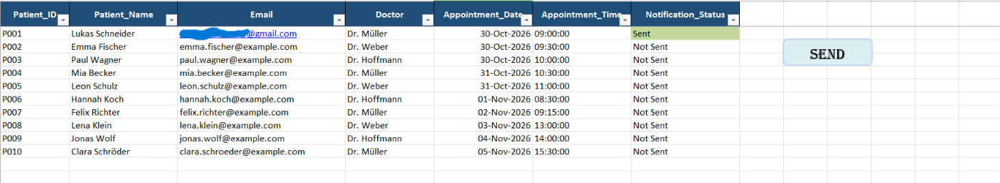
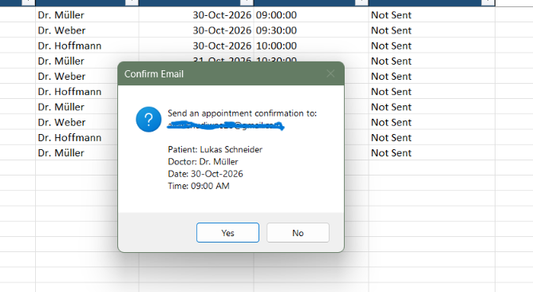

# Excel-Based Appointment Notification System

An automated appointment notification system built using **Microsoft Excel VBA and Google Apps Script**. It allows users to manage appointment records in Excel and send confirmation emails through Gmail with a single click.

## Project Overview

This project demonstrates how spreadsheet automation can simplify appointment management and reduce manual email communication.

Users can select an appointment record in Excel and trigger an automated confirmation email. The notification status is updated in the workbook based on the response.

## Key Features

- Manage patient appointment records in Excel.
- Validate patient and appointment details before sending.
- Send appointment confirmation emails through Gmail.
- Integrate Excel VBA with Google Apps Script.
- Update notification status as Sent or Failed.
- Use a confirmation prompt before sending emails.

## Technologies Used

| Technology | Purpose |
|---|---|
| Microsoft Excel | Appointment data management |
| VBA | Excel automation |
| Google Apps Script | Email automation |
| Gmail | Email delivery |
| GitHub | Version control and project hosting |

## System Workflow

1. Select an appointment record in Excel.
2. VBA retrieves and validates the appointment details.
3. VBA sends the information to the Google Apps Script web app.
4. Google Apps Script processes the request and sends an email through Gmail.
5. Excel updates the notification status.

## Project Files

- `Appointment.xlsm` – Macro-enabled Excel workbook.
- `AppointmentNotification.bas` – Exported VBA module.
- `code.gs` – Google Apps Script email service.
- `README.md` – Project documentation.

## Learning Outcomes

- Excel VBA automation.
- Integration between Excel and Google Apps Script.
- HTTP POST requests and JSON data exchange.
- Email automation using Gmail services.
- Input validation and error handling.

## Important Note

This project uses sample appointment data for demonstration purposes. Do not use real patient information, personal credentials, deployment URLs, or API secrets in a public repository.

## Project Screenshots

### 1. Appointment Management

### 2. Email Confirmation Process

### 3. Notification Status Tracking

### 4. Gmail Confirmation Email

## Author

**Avanshu Diwane**

[GitHub Profile](https://github.com/Avanshu-Diwane)
